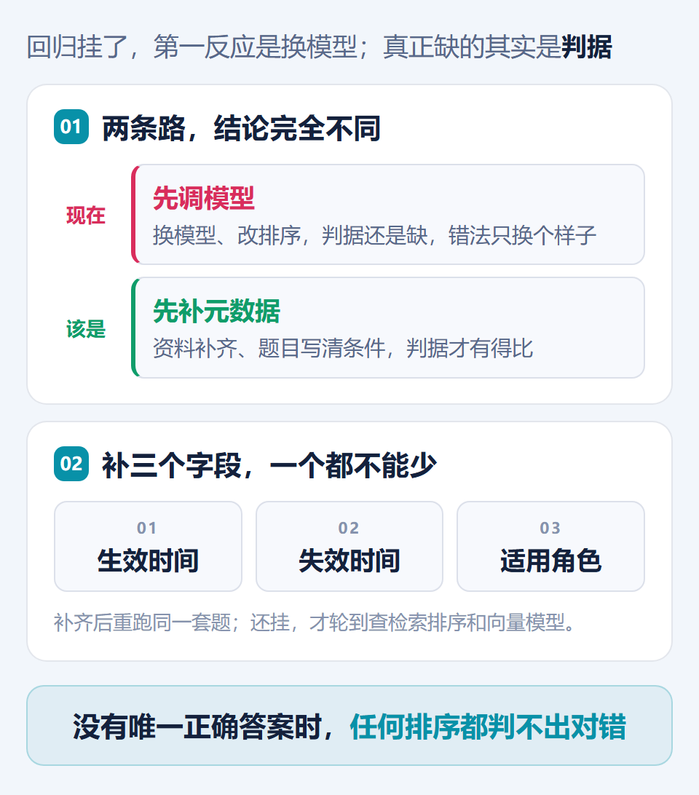
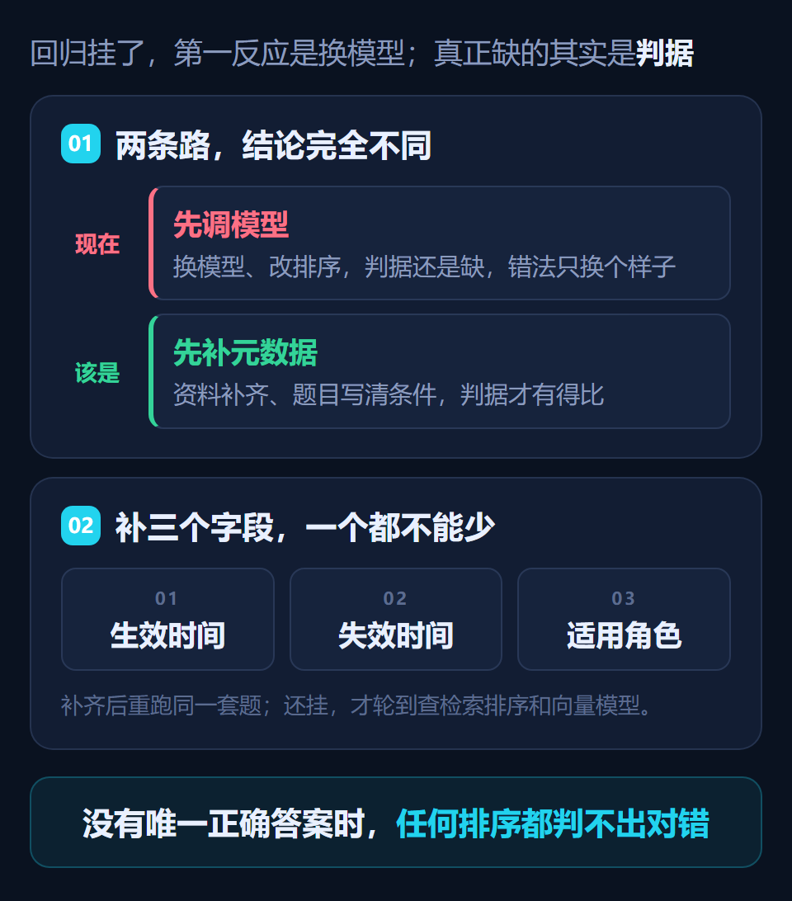

  
知识星图 / D2 知识工程 / 知识召回与 RAG / 判断卡 02

  

    

      D2-05 · 试点主题
      判断卡 02 / 02
      更新 2026-11-21
    

    <h1>版本条件不清，先别调模型</h1>
    
检索回归题失败时，怎么判断是检索排序的问题，还是题目本身没定义清楚？

  

  
结论
如果题目没写生效时间、没限定读者权限，<em>「正确版本」本身就无从定义</em>——这时候调排序、换模型都是白费。先补资料元数据与题目条件，再谈检索质量。

  

    

      

        
<i class="sig"></i>核心图解 · 顺序换一下，结论完全不同

        <figure class="ka-figimg">
          
          
        </figure>
        
读法：先调模型那条走到底，你会得到「好像还是不太准」；先补元数据那条走到底，你才知道检索到底行不行。

      

      

        
检索答错了，人的第一反应通常是去调参数、换个更大的模型。但如果题目本身没说清「时间是哪个时点、读者是哪个岗位」，那就不存在唯一正确答案——一份资料说 10 天、另一份说 15 天，两份都没标生效时间，模型返回哪个你都判不了对错。这时候调模型，只是把同一个不确定性换个地方发生。

        
顺序应该反过来：先给制度类资料补三个字段——<em>什么时候生效、什么时候失效、对谁适用</em>；再把时间点和读者角色写进回归题。补齐之后重跑同一套题，如果还是错，那才是检索排序或向量模型的问题，这时候动手调才有意义。

      

      <section class="ka-card-sec">
        <h2>01 失败边界</h2>
        <ul class="ka-evidence">
          <li><b>边界一</b>：资料 A（10 日）与 B（15 日）都无生效时间标注时，两版都算「正确」，Top 3 验收失去判据。</li>
          <li><b>边界二</b>：题目未限定读者角色，某版本仅对特定岗位生效，检索返回结果无法判定对错。</li>
          <li><b>边界三</b>：已失效资料未下架、也未标失效日期，检索把它当现行内容召回，属于数据治理问题而非算法问题。</li>
        </ul>
      </section>
      <section class="ka-card-sec ka-card-sec--action">
        <h2>02 复验与行动</h2>
        
在知识中心给每条制度类资料补三个字段：生效时间、失效时间、适用角色；回归题写明时间点和读者角色。补齐后重跑「命中哪一版」那套题，若仍失败，才进入检索排序与向量模型的排查。

      </section>
      

        <h5>小结 · 记住这句</h5>
        
回归失败时先问一句：<b>这题有唯一正确答案吗？</b>没有，就先去补元数据，别急着换模型。

        
三个字段是底线：生效时间、失效时间、适用角色。少一个，验收就站不住。

      

    

    <aside class="ka-card-aside">
      

        <h5>关联主题</h5>
        <a class="ka-rel-link" href="learn/d2/retrieval/check-current-policy/" data-no-popover="true">前三条命中了哪一版 · 先学</a>
        <a class="ka-rel-link" href="learn/d2/retrieval/" data-no-popover="true">D2-05 知识召回与 RAG</a>
        <a class="ka-rel-link" href="learn/d2/" data-no-popover="true">D2-06 元数据与标签 · 延伸</a>
      

    </aside>
  

  
复核触发：元数据字段或题目口径变化 · 更新 2026-11-21

  <nav class="ka-kp-nav">
    <a class="prev" href="learn/d2/retrieval/" data-no-popover="true">
← 返回主题

知识召回与 RAG
</a>
    <a class="next" href="learn/d3/skills/" data-no-popover="true">
下一主题 →

D3-06 Skills 与能力封装
</a>
  </nav>

