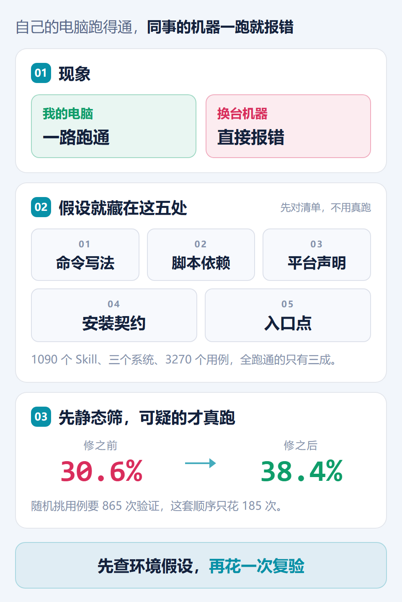

  
知识星图 / D3 智能体工程 / Skills 与能力封装 / 判断卡 03

  

    

      D3-06 · 试点主题
      判断卡 03 / 03
      更新 2026-11-22
    

    <h1>换台机器就跑不通</h1>
    
一个在自己电脑上跑通的 Skill，换台机器就失败，怎么判断是 Skill 的问题还是环境的问题？

  

  
结论
先查 Skill 里<em>写死的环境假设</em>——命令写法、脚本依赖、平台声明、安装方式，确认了再花一次动态复验。顺序反了，每次失败都要付一整轮执行才知道原因，而且大概率把环境问题记成模型能力问题。

  

    

      

        
<i class="sig"></i>核心图解 · 假设藏在这五处

        <figure class="ka-figimg">
          
          
        </figure>
        
读法：上面五格是「假设藏在哪里」，下面两个数字是「按这个顺序修完，通过率抬了多少」。抬到三成八还是不高——说明它只治环境这一层。

      

      

        
一个 Skill 在自己电脑上跑得挺顺，发给同事就报错，这种失败最容易被误判成「模型不行」。实际上很多是环境假设写死了：命令是 Linux 的写法、脚本依赖某个只在你这台机器装过的包、安装时默认了某个路径。论文扫了 1,090 个公开 Skill，能在三个平台上都跑通的只有三成左右。

        
他们的做法是先静态筛一遍——把说明文件里写的命令、脚本、平台声明、安装方式逐条对一遍目标环境，<em>不用真跑</em>；筛出可疑的再去跑。这样用 185 次执行就确认了 38 个真问题，均匀随机跑要八百多次。修完之后通过率从 30.6% 升到 38.4%，还是不高——说明这条路只排得掉环境问题，剩下的得靠别的办法。

      

      <section class="ka-card-sec">
        <h2>01 证据与复验</h2>
        <ul class="ka-evidence">
          <li><b>资料支持</b>：SkillBridge（arXiv 2611.26256，北大高可信软件技术重点实验室 × 西北工大 × 中关村学院，2026-11-19 提交，ICSE 2027 录用）指出 OS 假设分散在五处：guide 里让 agent 跑 <code>./script.sh</code>、脚本依赖 AppleScript 或 Windows COM、metadata 的平台声明、安装契约只写 Homebrew 或 apt、本地入口点缺失；扫了 1,090 个 skill 在 Linux/macOS/Windows 上的 3,270 个用例。</li>
          <li><b>资料支持</b>：同一篇论文的预算账——先静态筛证据、再挑少量用例动态验证，拿到 38 个确认的 OS 问题用了 185 次动态验证，均匀随机选要约 865 次；把出错的那个契约字段修好，评审判定的目标任务通过率从 30.6% 升到 38.4%。</li>
          <li><b>设计判断</b>：给 Skill 加的最小验收集——一行「运行环境」（OS / 解释器版本 / 路径写法 / 依赖怎么装）、一条 30 秒能跑完的冒烟命令、一条已知会失败的样本。这是按上面的契约字段推的落地做法，不是论文结论。</li>
        </ul>
        
复验方式：拿自己手上的 Skill 按五个契约字段逐条自查（guide 命令写法、脚本依赖、metadata 平台声明、安装契约、入口点），再换一台不同 OS / 不同解释器的机器跑冒烟命令；两次结论不一致，就应该先改契约而不是改提示词。

      </section>
      <section class="ka-card-sec ka-card-sec--action">
        <h2>02 边界与行动</h2>
        
这套方法只治操作系统与环境层，凭证缺失、服务不可用、夹具缺失、规划错误这四类混淆源要先排除；修完 38.4% 仍然偏低，说明环境只是必要条件。落地动作：给 SKILL.md 顶部加「运行环境」与冒烟命令，换环境复跑写进上线验收。

      </section>
      

        <h5>小结 · 记住这句</h5>
        
Skill 换机器失败，<b>先查环境假设，再花一次复验</b>。顺序反了，每次失败都要付一整轮执行，还会把环境问题记成模型能力问题。

        
最小验收集只要三样：运行环境一行、30 秒冒烟命令、一个已知失败样本。

      

    

    <aside class="ka-card-aside">
      

        <h5>关联主题</h5>
        <a class="ka-rel-link" href="learn/d3/skills/skill-or-connector/" data-no-popover="true">做 Skill 还是做连接器 · 先学</a>
        <a class="ka-rel-link" href="learn/d3/skills/read-only-first/" data-no-popover="true">能力可加，权限不可逆 · 延伸</a>
        <a class="ka-rel-link" href="learn/d3/skills/" data-no-popover="true">D3-06 Skills 与能力封装</a>
      

    </aside>
  

  
复核触发：换机器/换解释器复跑 · 更新 2026-11-22

  <nav class="ka-kp-nav">
    <a class="prev" href="learn/d3/skills/read-only-first/" data-no-popover="true">
← 上一张

能力可加，权限不可逆
</a>
    <a class="next" href="learn/d3/skills/" data-no-popover="true">
返回主题 →

Skills 与能力封装
</a>
  </nav>

