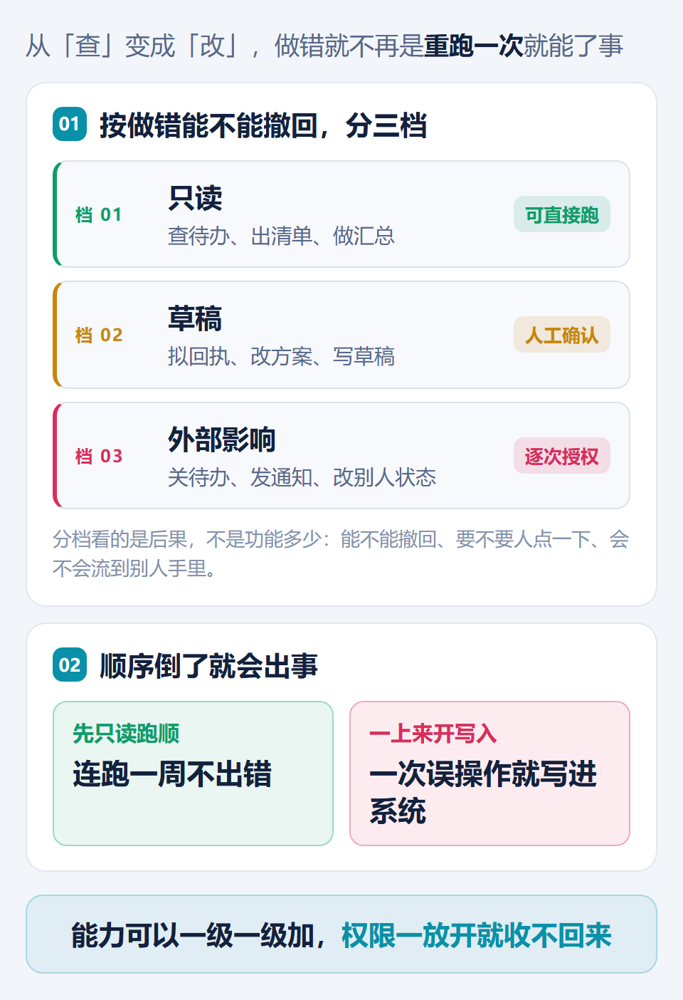
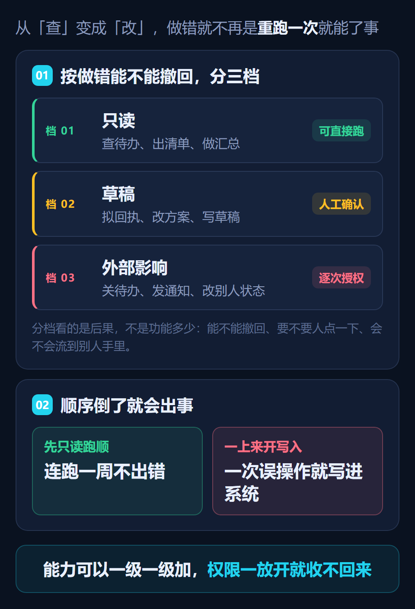

  
知识星图 / D3 智能体工程 / Skills 与能力封装 / 判断卡 02

  

    

      D3-06 · 试点主题
      判断卡 02 / 03
      更新 2026-11-21
    

    <h1>能力可加，权限不可逆</h1>
    
Skill 从「只读生成清单」升级到「修改或关闭待办」时，怎么防止一次演示变成不可逆的外部写入？

  

  
结论
把操作分成<em>只读 / 草稿 / 外部影响</em>三档。只读可直接跑；草稿可自动产出但人工确认；产生外部影响的写入必须显式授权、逐次留痕。Skill 升级能力时，权限档位只能逐级放开。

  

    

      

        
<i class="sig"></i>核心图解 · 三档动作怎么分

        <figure class="ka-figimg">
          
          
        </figure>
        
读法：从上往下是「做错了能不能撤回」的三个答案——能、要人点一下、不能。越往下，授权要求越高。

      

      

        
Skill 一开始基本都只读：查一下待办、算个数、生成一份清单。这类动作做错了，最多是清单不准，重跑一次就好。但一旦它开始写，性质就变了——关掉一条待办、发出一封通知、提交一个审批，这些在系统里是真实发生过的，撤回往往要走另一套流程，有时候根本撤不回。

        
所以判断一个 Skill 该给多大权限，不看它功能多不多，而看它<em>做错时能不能轻松回退</em>。这也解释了为什么必须按后果分档：同一个「整理待办」的 Skill，早上生成清单是只读，晚上批量关闭逾期项就是外部影响，两个动作得分开授权，不能因为「都是整理待办」就一起放开。

      

      <section class="ka-card-sec">
        <h2>01 证据与复验</h2>
        <ul class="ka-evidence">
          <li><b>边界一</b>：Skill 直接批量关闭待办，一旦归类规则有误，误关无法自动回滚。</li>
          <li><b>边界二</b>：无人工确认环节，模型把「生成明日清单」理解为「已通知相关人」，造成越权动作。</li>
          <li><b>边界三</b>：连接器令牌权限过大，Skill 复用时继承了超出任务的读写范围。</li>
        </ul>
      </section>
      <section class="ka-card-sec ka-card-sec--action">
        <h2>02 边界与行动</h2>
        
给 Skill 写清触发条件、步骤、验收与复用边界，并单列「动作档位」字段。首次上线只开放只读；写入能力先在模拟环境用可复跑任务验证，确认失败后能恢复，再申请授权。

      </section>
      

        <h5>小结 · 记住这句</h5>
        
Skill 的权限不是一次给的，是<b>按动作后果一级一级放</b>：只读随便跑，草稿要人点一下，真动外部系统必须显式授权并留痕。

        
自查一句：这个动作如果做错了，我能不能在五分钟内撤回来？不能，它就属于第三档。

      

    

    <aside class="ka-card-aside">
      

        <h5>关联主题</h5>
        <a class="ka-rel-link" href="learn/d3/skills/skill-or-connector/" data-no-popover="true">做 Skill 还是做连接器 · 先学</a>
        <a class="ka-rel-link" href="learn/d3/skills/" data-no-popover="true">D3-06 Skills 与能力封装</a>
        <a class="ka-rel-link" href="learn/d5/" data-no-popover="true">D5-03 权限、人工审批与动作审计 · 强相关</a>
      

    </aside>
  

  
复核触发：Skill 动作档位变更 · 更新 2026-11-21

  <nav class="ka-kp-nav">
    <a class="prev" href="learn/d3/skills/" data-no-popover="true">
← 返回主题

Skills 与能力封装
</a>
    <a class="next" href="learn/d3/skills/os-contract-check/" data-no-popover="true">
下一张 →

换台机器就跑不通
</a>
  </nav>

