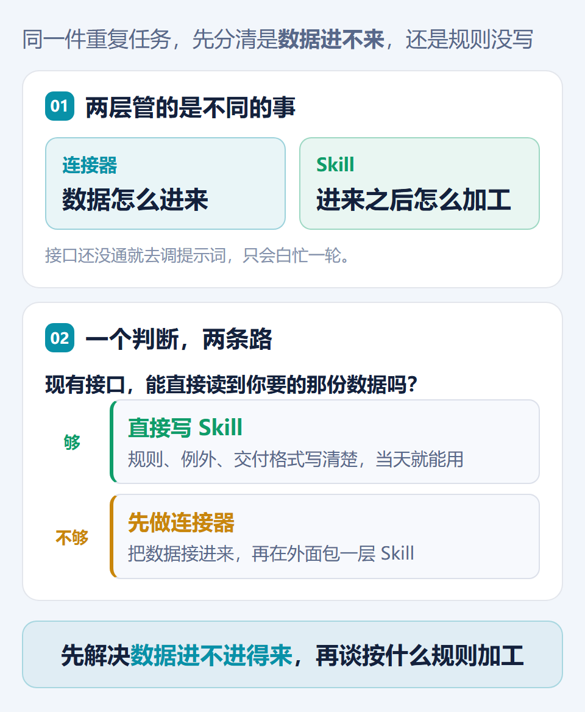

  
知识星图 / D3 智能体工程 / Skills 与能力封装 / 判断卡 01

  

    

      D3-06 · 试点主题
      判断卡 01 / 03
      更新 2026-11-21
    

    <h1>做 Skill，还是做连接器？</h1>
    
已有只读待办接口，要把「按紧急程度归类并生成明日清单」做成可重复任务，应该先做哪一层？

  

  
结论
读待办的接口可复用时，<em>先把归类规则、例外处理和交付格式封装成 Skill</em>。新增数据源或授权方式时，再评估连接器、以及是否需要经 MCP 接入。

  

    

      

        
<i class="sig"></i>核心图解 · 先问数据进不进得来

        <figure class="ka-figimg">
          
          
        </figure>
        
读法：这两层不是二选一，是有先后。数据进不来，Skill 写得再漂亮也跑不动；数据能进来，Skill 立刻就能见效。

      

      

        
想做「把待办按紧急程度归类、生成明日清单」，第一件纠结的事往往是「这算 Skill 还是连接器」。这两个东西管的事其实不一样：连接器解决「怎么把外部系统的数据拿进来」，Skill 解决「拿到数据之后按什么规则加工、交付成什么样」。

        
所以判断顺序是：先看现有接口够不够用。待办已经有只读接口了，数据这一层不缺，缺的是<em>归类规则、缺失截止时间怎么处理、清单长什么样</em>——这些都是 Skill 该写的。反过来，如果要去读一个还没有接口的系统，那才先做连接器（可能需要经 MCP 接），接完再在外面包一层 Skill。

      

      <section class="ka-card-sec">
        <h2>01 证据与复验</h2>
        <ul class="ka-evidence">
          <li><b>输入</b>：仅含「紧急 / 普通 / 缺失截止时间」三类的模拟待办。</li>
          <li><b>检查</b>：清单按预设规则分组、缺失项单列、对业务系统的操作为只读。</li>
          <li><b>规范依据</b>：Agent Skills 规范界定 Skill 的指令与资源组织方式；MCP 架构概览界定其接入角色与能力交换。</li>
        </ul>
        
选型结论是本案例的工程判断；规范只界定各自职责，不替你决定先做哪一层。

      </section>
      <section class="ka-card-sec ka-card-sec--action">
        <h2>02 边界与行动</h2>
        
若任务还要修改或关闭待办，先定义写入授权、人工确认与操作记录，再动手。首发演示一律走只读路径——能力可加，权限不可逆。

      </section>
      

        <h5>小结 · 记住这句</h5>
        
先问<b>数据能不能进来</b>：能，就写 Skill；不能，先做连接器。两件事别混在一次里做。

        
接口可复用的情况下，Skill 见效更快、风险也更小——它只需要读。

      

    

    <aside class="ka-card-aside">
      

        <h5>关联主题</h5>
        <a class="ka-rel-link" href="learn/d3/skills/" data-no-popover="true">D3-06 Skills 与能力封装</a>
        <a class="ka-rel-link" href="learn/d3/skills/read-only-first/" data-no-popover="true">只读先行 · 风险</a>
        <a class="ka-rel-link" href="learn/d5/" data-no-popover="true">D5-03 权限与动作审计 · 风险</a>
      

    </aside>
  

  
复核触发：Skill/MCP 规范更新或接口变更 · 更新 2026-11-21

  <nav class="ka-kp-nav">
    <a class="prev" href="learn/d3/skills/" data-no-popover="true">
← 返回主题

Skills 与能力封装
</a>
    <a class="next" href="learn/d3/skills/read-only-first/" data-no-popover="true">
下一张 →

能力可加，权限不可逆
</a>
  </nav>

