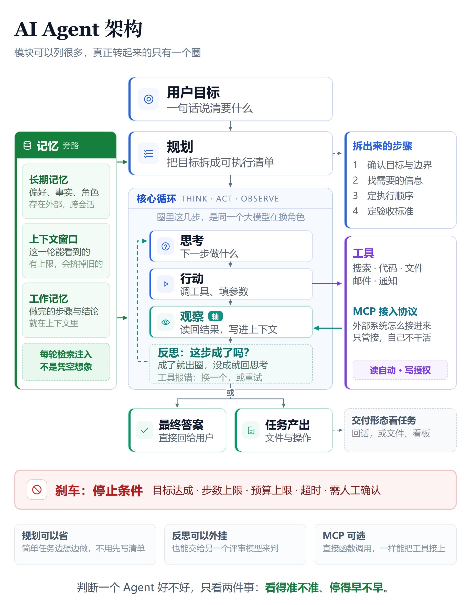

<h1>Agent 架构：模块再多，圈只有一个</h1>

<a href="../learn/d3/" data-no-popover="true">D3-01 智能体架构与执行循环</a>图文判断卡

问题
一张被转发很多的「AI Agent 完整架构」图，六个模块、方向都对，为什么照着搭还是跑不起来？到底哪里画错了？

结论
因为它把环和旁路压成了流水线：模块从左到右排成六站，而真正驱动下一轮的那一步被省略了。<em>Agent 只有一个圈——想清楚、动手、把结果读回来，判断成没成</em>；记忆、工具、协议都挂在圈外，刹车独立在圈外兜底。

<figure class="post-figure"><figcaption>一圈三步加一个判定：思考 → 行动 → 观察 → 反思。记忆是旁路，工具是手脚，刹车在圈外兜底</figcaption></figure>

<h2>模块不排队，只有一个圈</h2>
常见的画法是把目标、规划、推理、记忆、工具、反思编成 1 到 6，箭头一路往下。这种画法读起来顺，但它悄悄告诉人「照着顺序搭六个模块就行」，而 Agent 恰恰不是这么跑的。

真实结构只有一条主链：目标进来，拆成清单，进循环。记忆在左边随取随用，工具在右边随叫随到，两者都不是流程里的一站。把它们排进主链，因果就反了——<em>反思要基于观察的结果，观察又要基于工具真的跑完</em>。

<h2>观察是轴，不是第四步</h2>
圈里最容易被省略的是「把结果读回来」。很多图是想完就做、做完再想，中间那一读没了。可工具跑完不把返回写进上下文，下一步就没有依据，反思也无从谈起——圈是空转的。

所以它不是循环的第四步，是让这个圈成立的轴。判断这一步成没成，也是在这一步之后：成了出圈，给答案或交文件；没成回到思考，换个走法。工具报错同样是信息，不是意外，换一个工具或者重试，都是正常路径。

<h2>四个角色，一个模型</h2>
思考、行动、观察、反思听起来像四个模块，其实是一个大模型在被不同的提示词驱动着换角色。真正要搭的只有两样：<em>把上下文喂进去，把工具接进来</em>。以为要搭四套系统，是最常见的误解，也是最贵的误解。

<h2>记忆是检索，不是记住</h2>
记忆分三层，但分工要分清：长期记忆存在外部，跨会话保留偏好和事实；上下文窗口是这一轮能看到的全部内容，有上限，塞满了会挤掉旧的；工作记忆是已经做完的步骤和结论，就躺在上下文里。

每轮要做的是把相关的那一段检索出来注入，而不是「想象」出一段上下文。一词之差，理解就偏了。窗口有限，所以要挑、要压——这也是上下文工程真正要解决的问题。

<h2>工具要分读写，协议只是插头</h2>
工具不能无差别对待。搜索、读文件这类不改外部状态，可以自动跑；发邮件、改数据、下单这种真动外部系统的，得卡在授权上。多数产品把工具画成一个框，落地时最容易在这里出事。

MCP 不是第五个步骤，也不是工具清单。它是「外部系统怎么被统一接进来」的插头规格，属于协议层：<em>只管接，自己不干活</em>。内置工具和经 MCP 接入的工具是并列的，只是接入方式不同。

<h2>刹车：没有它，圈会一直转</h2>
停止条件至少要有一样：目标达成、步数到顶、预算烧完、超时、需要人工确认。缺了这个，循环会一直转到钱烧完为止。这是 Agent 落地最关键的设计，也是最常整块漏掉的。

所以判断一个 Agent 好不好，不用数它列了多少模块。只看两件事：<b>看得准不准</b>——观察和反思的质量，决定它能不能自己纠错；<b>停得早不早</b>——停止条件的设计，决定它可不可控。

<h2>边界：这套骨架不是唯一答案</h2>
<b>规划可以省。</b>简单任务不需要先写清单，边想边做就行，ReAct 本身就是隐式规划；图上把规划单独画出来，是为了讲清「目标先落成可执行的步骤」这件事。

<b>反思可以外挂。</b>可以由同一个模型自评，也可以交给独立的评审模型或规则校验，不一定非要在圈内。

<b>MCP 可选。</b>工具直接函数调用一样能接上，MCP 解决的是「多个外部系统用同一套方式接入」的问题，不是必需品。

