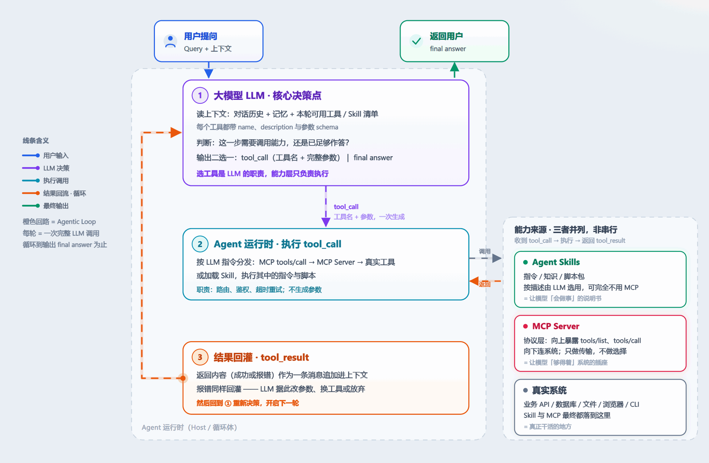

<h1>一张动图看懂 Agent 的真实运行机制</h1>

<a href="../learn/d3/" data-no-popover="true">D3-01 智能体架构与执行循环</a>图文判断卡

问题
Agent 到底怎么跑起来的？LLM 和运行时各管哪一段，为什么说「回灌」才是它能自我纠错的关键？

结论
它不是一条走完就结束的流水线，而是一个能转很多圈的 <strong>Agentic Loop</strong>：<em>LLM 每轮读上下文做决策，运行时按决策调工具，工具结果连报错一起回灌成下一轮输入</em>。转几圈不写死；所谓「自我纠错」，本质就是这条回灌通道。

<figure class="post-figure"><figcaption>一圈四个动作：LLM 决策 → 运行时执行 → 结果回灌 → 回到起点，直到 LLM 判断可以作答</figcaption></figure>

<h2>一圈</h2>
四个动作转一圈，转几圈由 LLM 自己判断

问题进来，LLM 读一遍上下文做判断，运行时按判断调工具，结果拼回上下文，回到起点。哪一轮觉得能答了，就输出结果、退出循环。

先放掉一个印象：它不是流水线。不是「调工具、总结、输出」走一遍就完，而是一圈可以转很多次。

<h2>分工</h2>
LLM 只做决策，运行时只跑腿，这条线不能反

<b>决策只有 LLM 在干。</b>它读三样东西：对话历史、记忆、这一轮可用的工具与 Skill 清单，每项都带名字、描述和参数格式。输出只有两种——给一个 tool_call（工具名加整套参数），或不调工具、直接回答。

有个细节常被忽略：<em>参数是 LLM 现场写的，不是运行时拼好的</em>。写不出参数，往往说明信息已经够了，它会转而直接回答。所以「能不能写出参数」本身就是隐形的停止信号。

<b>运行时只管跑腿。</b>拿到 tool_call 后做四件事：路由、鉴权、超时重试、把请求送到真正的系统。用什么工具、参数是什么，都不归它管——这条线画反，整张图的因果就错了。

跑腿有两条路：走 MCP 的 tools/call，到 MCP Server 再到底层工具；或加载 Skill，执行里面的指令和脚本。一个 tool_call 也可能并发多个请求，等全部回来再往下走。

<h2>回灌</h2>
报错回不来，它就永远不知道自己错了

工具返回的东西，<b>包括报错</b>，会当成一条新消息加进上下文，成为下一轮 LLM 的输入。这是整个机制里最关键的一环：正因为能看见自己上一步干砸了，它才会改参数、换工具，或承认这条路走不通。

报错要是回不来，它就只会一遍遍发同样的调用。

<h2>边界</h2>
三块是并列入口，不是一条串行链路

<b>能力来源</b>Skills、MCP Server、真实系统是并排的，各自独立入口

<b>选工具</b>框架只给清单和通路，挑哪个发生在 LLM 内部

<b>报错路径</b>只画成功返回，会让人误以为报错是意外

后两条是画图时最容易画错的地方：把「工具调度器」画成决策节点，好像框架在挑工具；只画成功路径，漏掉循环里最高频的信息来源。

<h2>停止</h2>
三种收尾里，只有第一种算真的跑完

LLM 给出答案轮次到顶被掐断外部中断

后两种都不算。所以一个 Agent 产品好不好，很大程度看它有多大比例能走到第一种就停下。经常撞上限，问题多半不在模型，而在工具描述写得含糊，让它反复试错。

